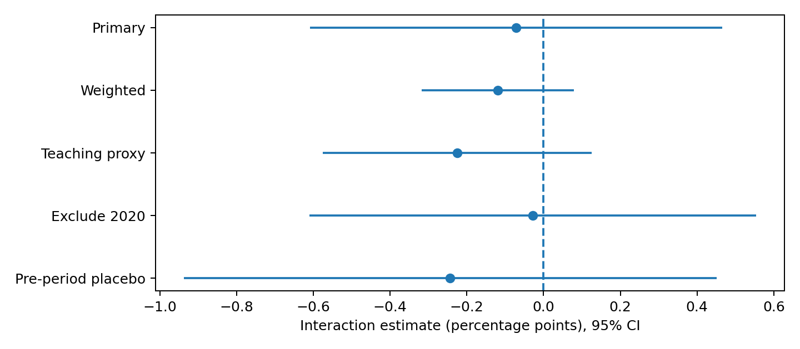
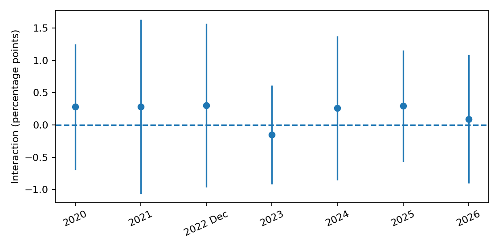

# Generative AI and the Early-Career Labor Market
### The Role of Occupational Learning Intensity

**Independent Empirical Research | AI Economics | Labor Economics**

[Read the Research Paper](Deeba_AI_Economics_Writing_Sample.pdf) ·
[Source Code](src/) ·
[Empirical Results](results/) ·
[Data Documentation](data/)

---

## Abstract

This study investigates whether occupational learning
intensity moderates the relationship between generative
AI exposure and early-career employment composition.

Combining labor market microdata, occupational AI exposure
measures, and occupational characteristics, the analysis
examines whether employment patterns differ across
occupations with varying opportunities for knowledge
acquisition and skill development.

The study contributes to the emerging literature on
AI-mediated labor market adjustment by examining
occupational learning as a potential moderating mechanism.

## Research Question

Does occupational learning intensity moderate the
relationship between generative AI exposure and
early-career employment composition?

## Research Contribution

- Examines occupational learning intensity as a
  potential dimension of labor market adjustment to AI.
- Integrates occupational exposure measures with
  employment and occupational characteristics.
- Evaluates heterogeneous employment patterns through
  panel-data econometrics.
- Reports statistical uncertainty and sensitivity
  across alternative specifications.

## Empirical Results

### Regression Estimates and Robustness

[Download regression results](results/results.csv)

### Dynamic Employment Patterns

[Download event-study results](results/event.csv)

## Data Sources

| Source | Research Application |
|---|---|
| IPUMS CPS | Employment and demographic measures |
| Anthropic Economic Index | Occupational AI exposure |
| O*NET | Occupational learning characteristics |
| U.S. Census Bureau | Occupational harmonization |

See the [data documentation](data/) for access information.

## Empirical Methodology

- Occupational classification harmonization
- Occupational learning intensity measurement
- Employment composition analysis
- Panel-data regression
- Occupation and time fixed effects
- Occupation-clustered standard errors
- Dynamic interaction analysis
- Robustness and placebo specifications

## Repository Structure

| Component | Description |
|---|---|
| `src/` | Python research implementation |
| `results/` | Statistical estimates |
| `figures/` | Research visualizations |
| `data/` | Data sources and access documentation |
| `requirements.txt` | Python dependencies |

## Technical Environment

Python, pandas, NumPy, SciPy, statsmodels, and matplotlib.

Install the listed dependencies using:

    pip install -r requirements.txt

## Interpretation and Limitations

The analysis estimates statistical associations rather
than identified causal effects.

Occupational learning characteristics are proxies for
learning opportunities, not direct measurements of
individual human capital accumulation.

Employment composition should not be interpreted as a
direct measure of hiring, displacement, or unemployment.

## Reproducibility and Research Integrity

Source code, statistical outputs, and research figures
are provided for methodological transparency.

Independent end-to-end replication remains outstanding.

AI-assisted research implementation was used in the
development of this project.

Restricted individual-level microdata are not distributed.

## Author

**Deeba Naveed**

Research interests: AI economics, labor economics,
applied econometrics, human capital formation,
and economic policy.
